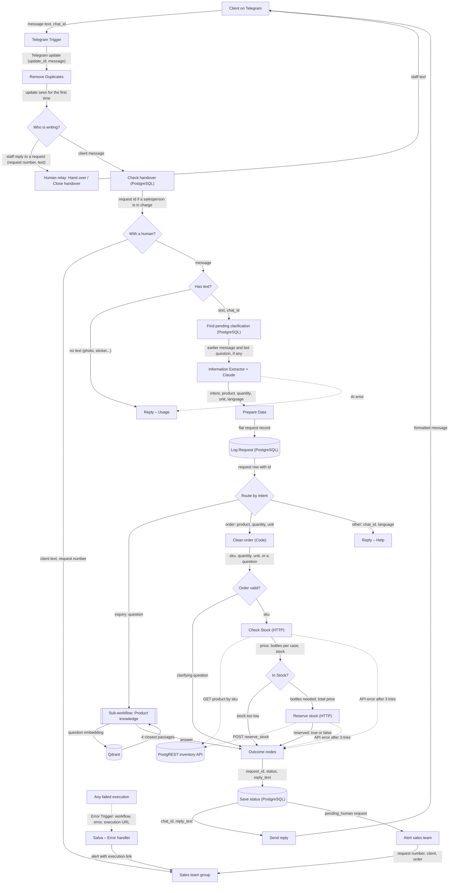
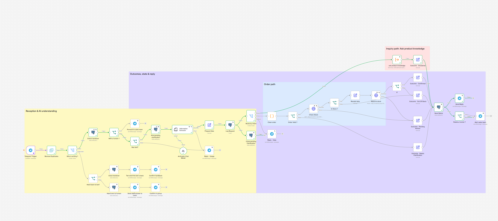
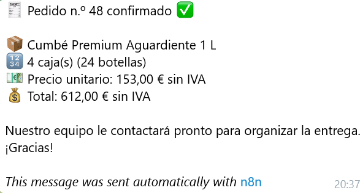
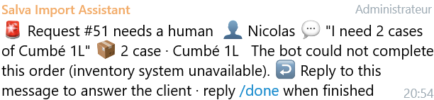
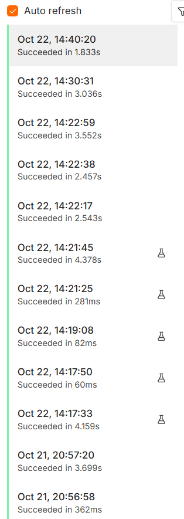

# Salva Import – B2B Order & Inquiry Assistant (n8n)

**The need:** Salva Import's B2B clients (bars and restaurants) want to ask questions about Cumbé
and place restock orders at any hour. Today they email a sales representative and wait for
business hours.

**What this project does:** a Telegram assistant, built with n8n and self-hosted with Docker
Compose, that:

- understands free text in English, French and Spanish (Claude), and replies in the client's language;
- answers product questions from the official Cumbé content (retrieval in a Qdrant vector database);
- takes orders: matches the product and bottle size, checks live stock through a REST API,
  reserves the bottles atomically and sends a priced receipt;
- asks a clarifying question when an order is incomplete and remembers the answer for 30 minutes;
- hands the conversation to the sales team in a private Telegram group when it cannot finish alone;
- logs every request with its status in PostgreSQL.

Production: `https://bot.cumbespirits.fr` (n8n editor and Telegram webhooks). Full report: [`docs/report.pdf`](docs/report.pdf).

---

## Architecture

Every arrow is labelled with the data it carries.



| Service | Role |
|---|---|
| **n8n** | The workflows (folder [`workflows/`](workflows)) |
| **PostgreSQL 17** | `requests` (every message and its status) and `products` (catalogue, prices, stock) |
| **PostgREST** | Inventory REST API in front of `products`; read-only role plus one reservation function |
| **Qdrant** | Vector database holding the product knowledge (embeddings by Google Gemini) |
| nginx (host) | HTTPS reverse proxy for `bot.cumbespirits.fr`, Let's Encrypt certificates |

Workflows:

- **Salva – Main**: the assistant (diagram above).
- **Salva – Product knowledge**: sub-workflow, input `question`, output `answer` (Question-and-Answer chain over Qdrant).
- **Salva – Load knowledge**: loads the official Cumbé content into Qdrant (run once, or after editing the text).
- **Salva – Error handler**: Error Trigger; posts the workflow name, error and execution URL to the sales group.
- **Salva – Error test**: a webhook that fails on purpose, to show the error path live.

**Level:** 3 (Advanced). The proposal's cut line (drop the inventory API and the vector database) was not needed.

## Repository layout

```
docker-compose.yml        services, pinned image versions, named volumes, DB healthcheck
.env.example              every environment variable (copy to .env, never commit .env)
db/init/01-schema.sql     tables, catalogue, reserve_stock() and cancel_order()
db/init/02-api-roles.sh   inventory API roles (password read from .env)
scripts/export-workflows.sh  exports the n8n workflows to workflows/
workflows/                n8n workflows as JSON (no credentials)
docs/                     report and screenshots
```

## Run it from a fresh clone

Prerequisites: Docker with Compose v2, a Telegram bot token (from @BotFather), an Anthropic API key,
a Google AI Studio key (embeddings), and a public HTTPS address pointing to n8n (Telegram only
delivers webhooks over HTTPS).

1. **Clone and configure**
   ```bash
   git clone <this repository> salva-bot && cd salva-bot
   cp .env.example .env
   openssl rand -hex 32        # paste the result as N8N_ENCRYPTION_KEY in .env
   nano .env                   # set the passwords (INVENTORY_API_DB_PASSWORD: letters and digits only)
   ```
   If your public address is not `bot.cumbespirits.fr`, change `N8N_HOST` and `WEBHOOK_URL` in
   `docker-compose.yml`.

2. **Create the reverse-proxy network** (it already exists on the production server, where the
   website's nginx uses it; elsewhere, create it once):
   ```bash
   docker network create cumbespirits_cumbe_network
   ```

3. **Start the stack**
   ```bash
   docker compose up -d
   docker compose ps          # 4 services running, postgres "healthy"
   ```
   On the first start, PostgreSQL runs `db/init/` automatically: tables, catalogue, functions and API roles.

4. **Import the workflows**
   ```bash
   docker compose cp workflows n8n:/tmp/workflows
   docker compose exec n8n n8n import:workflow --separate --input=/tmp/workflows
   ```

5. **Create the credentials** in n8n (Credentials → Create), then select them in the nodes:
   Telegram API (bot token), Anthropic, Google Gemini (PaLM) API, Postgres
   (host `postgres`, database/user/password from `.env`, SSL disabled), Qdrant (URL `http://qdrant:6333`).
   Put your sales group's chat ID in *Alert sales team*, *Forward to sales team*, the *Who is writing?*
   rule and the error handler.

6. **Load the product knowledge**: open *Salva – Load knowledge* and click *Execute workflow*.

7. **Publish** *Salva – Error handler*, *Salva – Product knowledge*, then *Salva – Main*.

## Environment variables

| Variable | Used by | Purpose |
|---|---|---|
| `POSTGRES_USER`, `POSTGRES_PASSWORD`, `POSTGRES_DB` | postgres, n8n credential | Database owner and name |
| `INVENTORY_API_DB_PASSWORD` | postgres init, PostgREST | Login password of the read-only API role |
| `N8N_ENCRYPTION_KEY` | n8n | Encrypts stored credentials; must never change once set |

Fixed in `docker-compose.yml`: `N8N_HOST`, `N8N_PROTOCOL`, `WEBHOOK_URL`, `N8N_PROXY_HOPS`, time zone.

## How to test

| Test | How | Expected |
|---|---|---|
| On demand, without Telegram | *Salva – Main* → *Execute workflow* (a test message is pinned on the trigger) | The tasting answer arrives in Telegram |
| Idempotency | *Execute workflow* a second time with the same pinned message | Stops at *Remove Duplicates*: no new row, no message |
| Product question | Send "Quel cocktail faire avec du café ?" | The Carajillo recipe, in French |
| Order | Send "I need 3 cases of Cumbé 1L" | Receipt: 18 bottles, 459.00 EUR excl. VAT; stock reduced by 18 |
| Memory (state across runs) | Send "Je veux 4 caisses de Cumbé", then "70 cl" | "70 cl or 1 L?", then a receipt for 4 cases of 70 cl |
| Invalid input | Send a sticker or a photo | Usage message |
| API failure | `docker compose stop inventory-api`, then send an order | "System busy" reply, alert in the sales group, status `pending_human` |
| Error workflow | Open `https://bot.cumbespirits.fr/webhook/error-test` | Alert in the sales group with the workflow name and execution link |

Restore after the failure test: `docker compose start inventory-api`.
Check the log: `docker compose exec postgres psql -U salva -d salva -c "SELECT id, intent, status FROM requests ORDER BY id DESC LIMIT 10;"`

## Operations

| Task | Command |
|---|---|
| Status | `docker compose ps` |
| Logs | `docker compose logs n8n --tail 50` |
| Export workflows to Git | `./scripts/export-workflows.sh` |
| Cancel an order (releases stock) | `docker compose exec postgres psql -U salva -d salva -c "SELECT cancel_order(N);"` |
| Database backup | `docker compose exec postgres pg_dump -U salva -d salva -f /tmp/backup.sql` |

## Security

- Secrets live only in `.env`, which is git-ignored; `.env.example` documents the variables.
- Workflow exports contain credential names, never credential values.
- Only nginx is public. PostgreSQL has no published port; PostgREST, Qdrant and n8n listen on `127.0.0.1` only.
- The inventory API role can read `products` and call `reserve_stock()`; it cannot modify tables or read client data.
- Every external call retries 3 times; unexpected failures trigger the error workflow.

## Screenshots

| | |
|---|---|
| Main workflow |  |
| Order receipt in Telegram |  |
| Sales team alert |  |
| Executions |  |
